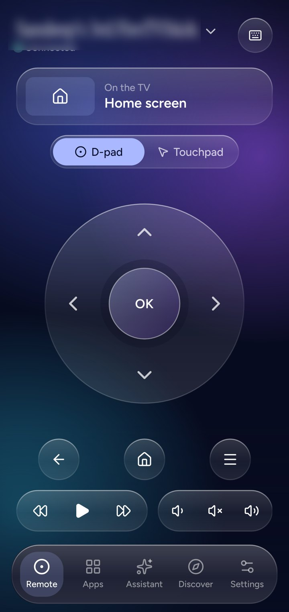
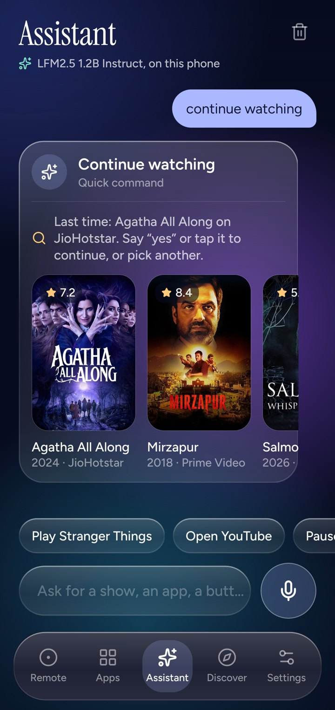
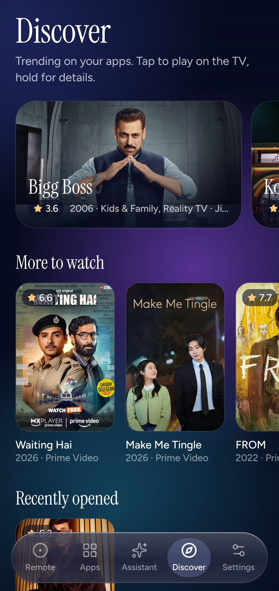

# Fireglass Remote

The phone side of [Fireglass](../README.md): a remote, keyboard and on-device AI assistant for a
Fire TV running the Fireglass launcher. Expo SDK 58, React Native 0.88, TypeScript. Android and iOS.

| | | |
|---|---|---|
|  |  |  |

## What it does

- **Finds the TV** on your Wi-Fi (mDNS `_tvhome._tcp`) or by IP, and pairs with a 4-digit PIN the
  TV shows. The token lives in the Keychain / Android Keystore.
- **Remote**: D-pad or touchpad, back/home/menu, media, volume, and a keyboard that types on the TV.
- **Starts the TV's key sender** after each TV reboot, by itself: it speaks just enough of the ADB
  protocol (`src/native/keysBootstrap.ts`, RSA key in secure storage) to run one shell command on
  the TV. The first time, the TV asks "Allow USB debugging?"; tick *Always allow*.
- **Assistant**: rule-based commands work instantly. For looser requests, download a model in
  Settings → Models and it runs on the phone with [llama.rn](https://github.com/mybigday/llama.rn),
  constrained by a grammar to the actions the TV understands. It knows your watch history, so
  "continue what I was watching" asks which one and resumes it in the right app.
- **Voice**: hold the mic, talk, let go.

Models offered: Qwen2.5 1.5B Instruct (1.1 GB), LiquidAI LFM2.5 1.2B Instruct (731 MB), Qwen2.5
0.5B Instruct (491 MB), all Q4_K_M GGUF from Hugging Face.

## Run it

```bash
npm install                      # also applies patches/ (llama.rn's iOS JSI install for RN 0.8x)
npm run mock-tv                  # a fake TV on :8090 that implements the whole API
npx expo prebuild                # generates android/ and ios/
npm run android                  # or: npm run ios, with a device or simulator
npm run build:apk                # release APK, arm64, debug-keystore signed
```

For iOS on a device, open `ios/TVHomeRemote.xcworkspace`, pick your team, and run; or
`xcodebuild ... DEVELOPMENT_TEAM=<team> -allowProvisioningUpdates`.

```bash
npm run typecheck && npm test
```

## Layout

| Path | |
|---|---|
| `src/app/` | Screens (expo-router): connect, remote, apps, assistant, discover, settings, models |
| `src/lib/` | API client, rule parser, action grammar and prompt, executor (tested) |
| `src/native/` | Speech, on-device model, model downloads, discovery, storage, ADB bootstrap |
| `src/ui/` | Glass, D-pad, touchpad, sheets, theme |
| `mock-tv/` | Node mock of the TV API ([docs/remote-api.md](../docs/remote-api.md)) |
